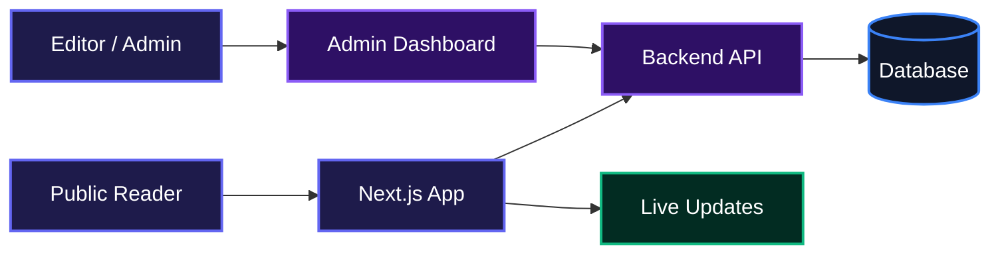
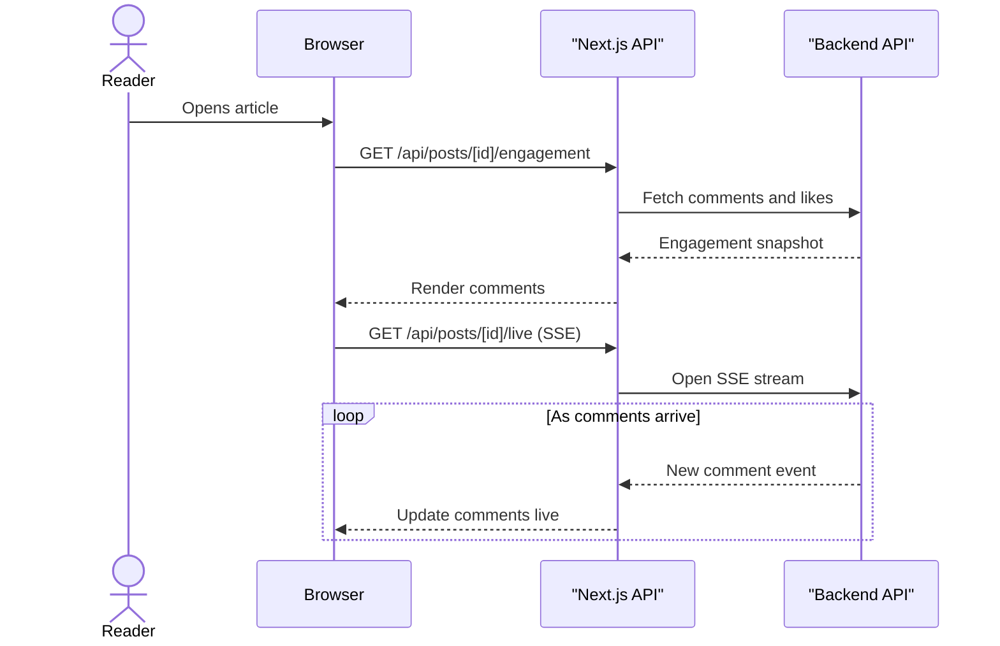
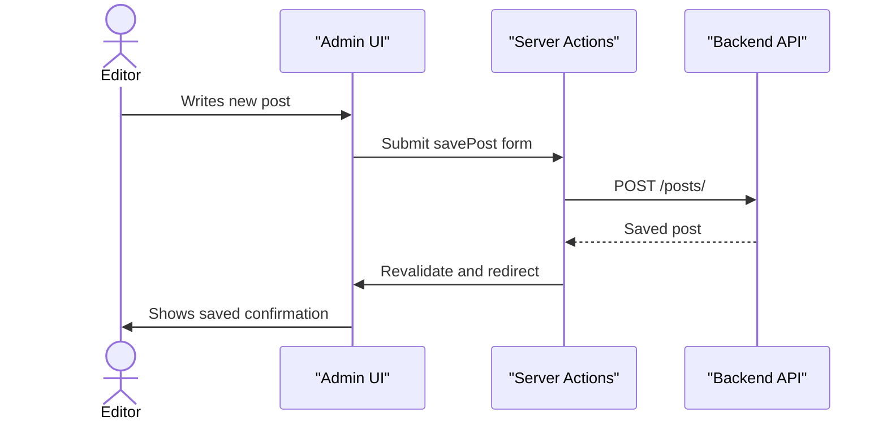

# News 24 — Modern Publishing Platform

## Overview

News 24 is a modern online newsroom that lets a publication publish stories, manage writers and podcasts, and talk with readers in real time. It gives editorial teams a clean dashboard to write and publish content, while giving readers fast search, comments, and social sharing. Everything is built for speed, accessibility, and a great reading experience on any device.



## Features

### Public News Site

A fast, responsive site with a homepage, blog index, category pages, writer profiles, podcast pages, and an about page. Each page uses static generation where it makes sense, so the site stays quick.

### Real-Time Comments and Engagement

Readers can like posts, leave comments, reply to each other, and see new activity appear live without refreshing. The frontend proxies a Server-Sent Events stream from the backend so real-time updates reach the browser safely.



### Admin Dashboard

Editors can create and edit posts, manage categories, and handle user roles. The dashboard shows live stats, a post list with filters, and inline forms with validation.



### Search

A site-wide search overlay lets readers find posts as they type. Search results come from the backend through a Next.js API route, so the API base URL never needs to be exposed to the browser.

## Installation

1. **Clone the repository**

```bash
git clone git@github.com:philtechphilips/news-24.git
cd news-24
```

2. **Install dependencies**

```bash
npm install
```

3. **Set up environment variables**

Create a `.env.local` file at the root:

```bash
NEXT_PUBLIC_API_URL=https://your-backend-api.example.com
```

The app also needs the backend API to be running. Point `NEXT_PUBLIC_API_URL` to your API instance.

4. **Run the development server**

```bash
npm run dev
```

Open [http://localhost:3000](http://localhost:3000) in your browser.

5. **Build for production**

```bash
npm run build
npm start
```

## Usage

Once the app is running, you can:

- Browse the public site at `/`
- View all stories at `/blogs`
- Filter by category at `/category/[slug]`
- Read writer profiles at `/writers/[slug]`
- Listen to podcasts at `/podcasts/[slug]`
- Access the admin dashboard at `/admin` (admin account required)

The admin area supports:

- Creating and editing posts with markdown-style body input
- Publishing or saving drafts
- Managing categories
- Managing users and admin roles

## API Documentation

The project includes several Next.js API routes that proxy requests to the backend.

### GET /api/posts?page=N

Fetches a paginated page of published posts.

**Request**:

```text
GET /api/posts?page=2
```

**Response**:

```json
{
  "page": 2,
  "pageCount": 5,
  "posts": [
    {
      "slug": "sample-post",
      "title": "Sample Post",
      "excerpt": "A short summary...",
      "image": "https://images.unsplash.com/photo-...",
      "categoryName": "Technology"
    }
  ]
}
```

**Errors**:

- `400`: Page parameter is not a positive integer
- `502`: Backend posts service is unavailable

---

### GET /api/search?q=...

Searches published posts through the backend by title, excerpt, body, and category name.

**Request**:

```text
GET /api/search?q=markets
```

**Response**:

```json
[
  {
    "slug": "fed-rate-decision",
    "title": "Fed Rate Decision",
    "image": "https://...",
    "category": "Economy"
  }
]
```

**Errors**:

- `502`: Backend search service is unavailable

---

### GET /api/posts/:id/engagement

Returns a post's comments, like/share counts, and the current viewer's state.

**Request**:

```text
GET /api/posts/123e4567-e89b-12d3-a456-426614174000/engagement
```

**Response**:

```json
{
  "comments": [],
  "likes": 42,
  "shares": 7,
  "viewer": {
    "id": "user-uuid",
    "name": "Jane Doe",
    "isAdmin": false
  }
}
```

**Errors**:

- `404`: Post not found or invalid UUID
- `502`: Engagement service is unavailable

---

### GET /api/posts/:id/live

Opens a Server-Sent Events stream for live comments, likes, and shares on a post.

**Request**:

```text
GET /api/posts/123e4567-e89b-12d3-a456-426614174000/live
```

**Response**:

Stream of SSE events containing live engagement updates.

**Errors**:

- `404`: Post not found or invalid UUID
- `502`: Live updates service is unavailable

## Technologies Used

| Technology | Description |
|---|---|
| [Next.js](https://nextjs.org/) | React framework for production-grade apps |
| [React](https://react.dev/) | UI library for building component-based interfaces |
| [TypeScript](https://www.typescriptlang.org/) | Typed JavaScript for safer code |
| [Tailwind CSS](https://tailwindcss.com/) | Utility-first CSS framework |
| [ESLint](https://eslint.org/) | Linting for code quality |

## Contributing

Contributions are welcome. If you would like to improve the project, feel free to open an issue or pull request. For detailed guidelines, check the repository issue tracker.

## Author

Built with care by **Pelumi Isola**.

- [LinkedIn](https://linkedin.com/in/Pelumi Isola)
- [X (Twitter)](https://x.com/softwareengng)

## Badges

[](https://www.typescriptlang.org/)
[](https://nextjs.org/)
[](https://react.dev/)
[](https://tailwindcss.com/)

[](https://dokugen.samueltuoyo.com)